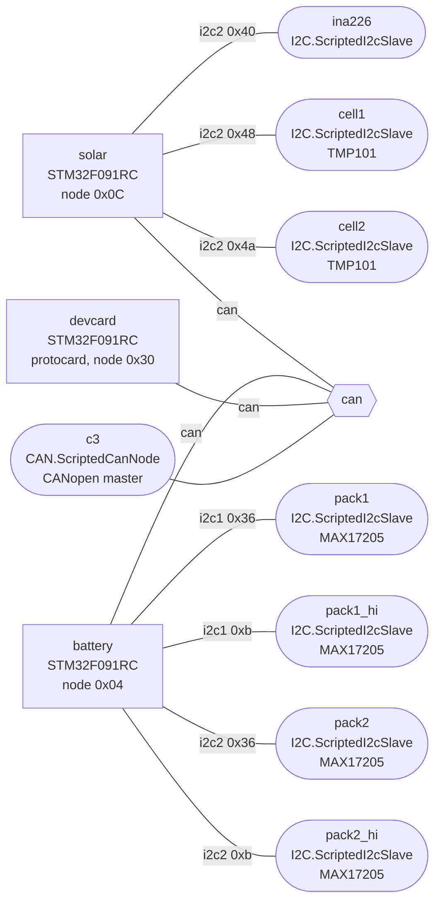

## This fork: the flown OreSat cards on simulated STM32F091s, talking CANopen

This is Simantic's fork of the Portland State Aerospace Society's OreSat firmware. It runs the OreSat 0.5 card firmware,
unmodified, on simulated STM32F091RC microcontrollers: a solar card, a battery card and a protocard on one CAN bus, with a
scripted C3 as the CANopen master. The cards boot, announce themselves with NMT boot-up, heartbeat, answer SDO reads and
writes, obey NMT commands and publish their TPDOs, all over the simulated bus. No board, no bench. No firmware or source
file in this fork is changed; this README, `./demo` and `sim/` are added.


```sh
./demo        # needs `sim` 0.10.3 or newer: curl -fsSL https://simantic.com/install | sh, then `sim update`
```

The GIF is real time: 11 s of virtual time take about 12 s on an Apple M-series Mac. Every value is what a flight card
answered over CANopen; the sensor readings behind them come from the Python peers listed below.

**Which firmware:** `main` of this repository is the Zephyr port, a manifest repository whose apps live in separate
repositories and whose solar and magnetometer cards target an NXP MCXN947, which `sim models` does not list; its STM32
battery card is the only part on a modelled core and it would run alone. The scenario therefore uses the ChibiOS firmware
on branch **`oresat05-master`**, the code the OreSat0.5 cards fly: all of its cards are STM32F091RC, so several run on
one bus. The ELFs were built from commit `1494f1c` of that branch (ChibiOS `d96c2af`, CANopenNode `8c7d852`) with the
stock `make`, plus `USE_BOOTLOADER=no` (link at 0x08000000 rather than behind the OreSat bootloader) and, for the battery
card, `USE_COPT=-DDEBUG_PRINT` (the debug console the solar app already has on). Both are variables the Makefiles define.
The scenario (`sim/scenario.yaml`), board files, Python peers and pre-built ELFs are in `sim/`; the ELFs are GPL-3.0
binaries of the source above, and `sim/build.sh` rebuilds them from a checkout.

**The scenario**, as `sim graph --scenario` prints it. The square boxes are the simulated MCUs running the firmware, the
rounded boxes are the modelled parts around them, and the hexagon is the CAN bus. `c3` is the CANopen master; it is parked
on the protocard because a scripted CAN peer cannot talk to the machine it is parked on, and that card is not under test:



| Device | Bus | Peer |
| --- | --- | --- |
| INA226 power monitor (solar) | I2C2, 0x40 | register file: bus voltage 4.80 V, current 150 mA through the 0.1 ohm shunt (CAL written by the firmware), reset bit self-clears, conversion-ready always set |
| TMP101 x2 (solar cells 1 and 2) | I2C2, 0x48 and 0x4A | temperature register, 21 C and 23 C |
| MAX17205 fuel gauge x2 (battery packs 1 and 2) | I2C1 and I2C2, 0x36 (registers 0x000-0x0FF) and 0x0B (0x100-0x1FF) | 16-bit register file that keeps what the firmware writes (its NV-RAM read-back checks come out `CORRECT`); pack 1 at 3.70 V per cell, 24 C, -150 mA, 98 %; pack 2 at 3.65 V, 26 C, -120 mA |
| C3 (CANopen master) | CAN, 11-bit ids | NMT boot-up and heartbeat watcher; SDO expedited upload and download; NMT stop and start; logs TPDOs |
| Node ids | DATA0 option byte | 0x0C solar, 0x04 battery, 0x30 protocard, set per card with the `optionByteData0` board key |

**What the C3 does, at virtual times:** 1.5 to 2.0 s, SDO reads of the solar card's `output.voltage`, `output.current`,
`output.power` and both cell temperatures; 4.0 to 4.6 s, SDO reads of the battery card's pack voltage, cell voltage,
current, temperature and state of charge (after its first pack-read loop, which starts about 3.3 s in because the debug
build prints the gauge's whole register map first); 5.0 to 5.2 s, reads the solar card's heartbeat producer time (1000 ms),
writes 250 ms, reads it back; 8.0 s NMT stop and 9.0 s NMT start to the solar card; 10.2 s a last SDO read.

**What our simulator CI checks on every change** (Simantic's own test of this scenario): the run must show
- solar console: `Starting TMP101`, `Running solar app...`, `Done with init INA226, running main loop....`;
- battery console: `Starting battery Node ID: 0x4`, `max17205Start(Pack 1) = 1` and `(Pack 2) = 1`,
  `All NV RAM elements now match expected values.`, `Batteries are not critically low`, and the first pack read,
  `cell1 = 3700, cell2 = 3700, vcell = 3700, max = 3700, min 3680, batt = 7400` and `reported = 98%`;
- NMT: boot-up of all three nodes, then operational, then heartbeats every 1000 ms;
- SDO uploads: solar 4800 mV, 150 mA, 720 mW, 21 C, 23 C; battery 7400 mV, 3700 mV, -150 mA, 24 C, 98 %, and pack 2 at
  3650 mV and 26 C;
- SDO download: heartbeat producer time 1000 ms, download accepted, 250 ms read back, and the heartbeats now 250 ms apart;
- NMT stop: the solar card reports `stopped`, and answers SDO reads after the restart;
- TPDOs: solar TPDO1 `c0129600d002c012` (4800 mV, 150 mA, 720 mW, 4800 mV average, little endian) and battery TPDO1
  `e81c740e600e740e` (7400, 3700, 3680, 3700 mV), both sent when the 10 s event timer fires;
- and none of these appear: `HardFault`, `SDO abort`.

**Console and bus excerpts** from a run of the full scenario (`sim` built from the `oresat/can-fixes` branch of pyrite, see
below; edited only by trimming the long register dumps):

```
[solar] Starting TMP101
[battery] Starting battery Node ID: 0x4
[solar] Running solar app...
[solar] Initializing INA226....
[solar] Done with init INA226, running main loop....
[c3] NMT node(0x30) boot-up
[c3] NMT solar_1(0x0C) boot-up
[c3] NMT battery_1(0x04) boot-up
[battery] max17205Start(Pack 1) = 1
[battery] Batteries are not critically low
[battery] All NV RAM elements now match expected values.
[c3] NMT solar_1(0x0C) operational
[c3] heartbeat solar_1(0x0C) every 1000 ms
[c3] SDO upload ok solar_1(0x0C) 4000:01 output.voltage = 4800 mV
[c3] SDO upload ok solar_1(0x0C) 4001:01 cell_1.temperature = 21 C
[battery] Voltage (mV):    cell1 = 3700, cell2 = 3700, vcell = 3700, max = 3700, min 3680, batt = 7400
[c3] SDO upload ok battery_1(0x04) 4000:01 pack_1.vbatt = 7400 mV
[c3] SDO upload ok battery_1(0x04) 4001:12 pack_2.temperature = 26 C
[c3] SDO download solar_1(0x0C) 1017:00 producer_heartbeat_time = 250
[c3] SDO download ok solar_1(0x0C) 1017:00
[c3] heartbeat solar_1(0x0C) every 250 ms
[c3] NMT stop solar_1(0x0C)
[c3] NMT solar_1(0x0C) stopped
[c3] TPDO1 solar_1(0x0C) data=c0129600d002c012
[c3] TPDO1 battery_1(0x04) data=e81c740e600e740e
```

and, from `--frames`, the first SDO exchange on the wire (device type of the solar card, expedited 4-byte reply):

```
[devcard] [1.500121s] (can0) CAN Tx id=0x60C dlc=8 data=40 00 10 00 00 00 00 00
[solar] [1.500121s] (can0) CAN Rx id=0x60C dlc=8 data=40 00 10 00 00 00 00 00
[solar] [1.500333s] (can0) CAN Tx id=0x58C dlc=8 data=43 00 10 00 00 00 00 00
```

It needs `sim` 0.10.3 or newer, which adds the two simulator fixes below (an earlier `sim` rejects the
`optionByteData0` board key). `./demo` filters the CANopen master's lines; to see every card's console and every CAN
frame, run the scenario directly from the repository root:

```
sim run --scenario sim/scenario.yaml --timeout 12
```

**Configurations tried:**

| Configuration | Result |
| --- | --- |
| A card ELF alone on the model, no bus peer (`sim STM32F091RC run --elf ...`) | Starts, runs, then idles; no CAN frame is logged (a lone node has nobody on the bus). |
| Default `make` of each app (linked at 0x0800A000 behind the bootloader) | The image is not at 0x08000000, so `sim` prints `Boot: core0 cortex-m0 pc=0x00010100 ... not from a --elf image` and the core locks up (`CPU LOCKUP`, HardFault). Hence `USE_BOOTLOADER=no`. |
| Crystal not declared (the model assumes 8 MHz; the OreSat boards have 16 MHz) | Boots, but every clock is half speed: heartbeats every 2000 ms instead of 1000 ms, 500 ms after the SDO write of 250 ms. `sim` warns `rcc: firmware enabled HSE but the board declares no rcc hseFrequency`. Declared as 16 MHz in the board files. |
| Solar card with no INA226 or TMP101 attached | The firmware reports it: `Failed to initialize INA226!!!`, `Failed to read cell 1 temperature: 4`, and keeps running. |
| Battery card with a gauge that answers every register with 0 | `max17205ReadVoltage(0xD4 MAX17205_AD_AVGCELL1) = 0 mV`, `Batteries are critically low!`; the pack records stay at 0 in the SDO and TPDOs. The gauge peer therefore serves the registers the firmware reads (cell and pack voltage, current, the temperatures in tenths of a kelvin, capacity, state of charge). |
| Three cards and the C3, with the `optionByteData0` key but before the bxCAN filter fix | Boot-up and heartbeats are fine and `--frames` shows each SDO request arriving at the card (`CAN Rx id=0x60C`), but no SDO is ever answered and NMT stop is ignored. |
| All three cards, with the fixes | Passes: the list of assertions above. |

**Two fixes to the simulator** came out of this (Simantic's pyrite, branch `oresat/can-fixes`):
- **bxCAN 16-bit filter banks.** The model had the two 16-bit halves of each filter register swapped (and RTR and IDE
  exchanged), so in a list bank the filter match index (FMI) was wrong and in a mask bank the id and mask were reversed.
  CANopenNode ports such as this one use the FMI as the index of the receive buffer (`filter = bank*4 + index%4`), so every
  frame was handed to the wrong handler and nothing was answered. RM0091 Figure 314 has FR1[15:0] first (filter n), then
  FR1[31:16], FR2[15:0], FR2[31:16]; each half is STID[10:0] in bits 15:5, RTR in 4, IDE in 3.
- **Node id in the option bytes.** The cards read their node id from the DATA0 option byte (`FLASH->OBR`), written on
  hardware by `flash_node_id.py`; `--preload` cannot reach the option-byte region, so a new `optionByteData0` board key
  programs it. Without it every card is node 0x7C.

**What is not simulated:** the C3's own software (only the NMT and SDO services and the PDOs are exercised; no SYNC, TIME or
EMCY traffic is sent or checked), the other OreSat cards (ADCS, reaction wheel, magnetometer, GPS, star tracker, radios),
the OreSat bootloader and the firmware-update path, the Zephyr cards. The INA226 and TMP101 readings are constants:
the solar card's DAC and boost-converter loop is not closed, so the MPPT keeps reporting a flat curve
(`calculated slope as 2147483647/10,000`). The MAX17205 is a register file, not a gauge: its state of charge, capacity and
cycle count do not evolve, and the battery's flash history, heaters and charge-control lines are not observed. The
on-chip temperature sensor and reference ADC channels, the LEDs and the card-to-card power-domain lines are unobserved.
No comparison against hardware has been done: everything here is simulator output.

**Observations on the firmware**, noted while building the peers, not changed here:
- the solar app's `solar` and `sensor_mon` threads both write USART2 through `chprintf` without a lock, so with the
  INA226 missing their lines interleave character by character (`RunFnaiinlge ds otloa rr eaapdp .c.e.ll`);
- the stock (bootloader) `make` of each app exits with `POST_MAKE_ALL_RULE_HOOK` Error 1 on this host (macOS,
  arm-none-eabi-gcc 15.2.1) after the ELF is linked; the `USE_BOOTLOADER=no` build finishes cleanly. Not investigated.

Everything below is the Portland State Aerospace Society's README.

---

# Oresat Zephyr Getting Started Guide

This documents how to install and use the Oresat firmware for Zephyr.

---

**ATTENTION:**

**The `main` branch in the `oresat-firmware` repository is now the one used for Zephyr, and is now the default branch.
Previous references to a `zephyr` branch are no longer correct, and have been changed below.**

**The old `master` branch containing ChibiOS firmware for STM32-based cards is now called `oresat05-master`.**

---

## Setup

> **NOTE 1:** This mostly rework of the [Zephyr Getting Started Guide].

> **NOTE 2:** Below we use `~/src/oresat/firmware` as the root folder for installing all the source code. Modify as you wish.

> **NOTE 3:** A document explaining the [Oresat Zephyr Repository Organization] is here.

### Select and Update OS

The instructions below apply to Debian-based Linux distributions and Arch Linux. For Windows or MacOS, follow the
related information in the above guide.

Update your OS with its latest packages.

### Install dependencies

- Arch Linux

    ```bash
    sudo pacman -S git cmake ninja gperf ccache dfu-util dtc wget \
      python-dev python-pip python-setuptools python-tk python-wheel \
      xz file make sdl2 stlink
    ```

- Debian Linux

    ```bash
    sudo apt install --no-install-recommends git cmake ninja-build gperf \
      ccache dfu-util device-tree-compiler wget python3-dev python3-venv python3-tk \
      xz-utils file make libsdl2-dev libmagic1 \
	   python3-pip python3-setuptools python3-wheel stlink-tools
    ```
    For the curious, this is mostly the same list as in the official getting started guide,
    except that we do not require: `gcc gcc-multilib g++-multilib`
	 but instead add: `python3-pip python3-setuptools python3-wheel stlink-tools`

Make sure you have at least the minimum required versions of:

1. CMake: 3.20.5
  `cmake --version`
2. Python: 3.10
  `python3 --version`
3. Devicetree compiler: 1.4.6
  `dtc --version`

**The versions could be higher for later versions of Zephyr than the 4.2.0 referenced here.**

### Get Oresat common code, Zephyr, and Python dependencies

#### Create a new virtual environment:

```bash
python3 -m venv ~/zephyrproject/.venv
```

#### Activate the virtual environment:

```bash
source ~/zephyrproject/.venv/bin/activate
```

Once activated your shell will be prefixed with (.venv). The virtual environment can be deactivated at any time by running deactivate.

**Note**

Remember to activate the virtual environment every time you start working.

#### Install west:

```bash
pip install west
```

Alternatively, your OS's package manager might have a west package. Debian Testing does:
```bash
sudo apt install west
```

**However** it is highly recommended to use the pip (or uv) version as it will be the most up-to-date.

#### Get the source code for common firmware repo, all apps, zephyr, and zephyr modules:

> **NOTE:**
>
> **Here are the main deviations from the [Zephyr Getting Started Guide]:**
>
> 1. *We initialize `west` from the main branch of our common firmware repository, not from Zephyr itself.*
> 2. *The common firmware main branch contains a `west.yml` file which intentionally selects a specific Zephyr official release.
> The Zephyr `main` branch is too much in flux to base a real project like Oresat on.*

```bash
mkdir -p ~/src/oresat/firmware
cd ~/src/oresat/firmware
west init -m https://github.com/oresat/oresat-firmware --mr main
west update
```

#### Updating to a newer release of oresat-firmware main branch:

> **IMPORTANT: when a newer version of this is available, you must do these steps!**

1. If you changed anything in the code (in an app, here in common, or in zephyr), follow the instructions in [Oresat Zephyr Repository Organization-Tasks]
2. Do **west patch clean** -- this undoes any patches applied to the zephyr, modules, or bootloader trees by a previous *west update*; should be no errors
3. Do **cd ~/src/oresat/firmware/common** -- change directory to the `common` folder; this is where the contents of `oresat-firmware` `zephyr` branch are
4. Do **git pull** -- pull in the latest changes to the `oresat-firmware` `zephyr` branch
5. Do **west update** and watch the log output – it will likely switch away from your branch, and tell you this, and give you directions how to switch back;
	  **watch for errors and if any, ask for help before proceeding!**
6. Do **west patch apply** -- this applies any patches in the zepyr-firmware/main branch to the zephyr, modules, or bootloader trees by this *west update*;
	  warnings are ok; **watch for any errors and if any, ask for help before proceeding!**

```bash
west patch clean
cd ~/src/oresat/firmware/common
git pull
west update
west patch apply
```

#### Export Zephyr CMake package:

```bash
west zephyr-export
```

#### Install Python dependencies:

```bash
west packages pip --install
```

#### Install the Zephyr SDK:

```bash
cd ~/src/oresat/firmware/zephyr
west sdk install
```

#### Export Zephyr environment:

```bash
cd ~/src/oresat/firmware/zephyr
source ./zephyr-env.sh
```
**NOTE: it is helpful to also add these to your ~/.bashrc:**
```
export ZEPHYR_SDK_INSTALL_DIR=$HOME/zephyr-sdk-0.17.2
export ZEPHYR_TOOLCHAIN_VARIANT=zephyr
```
Obviously use the SDK version number actually installed. It could be `0.17.2` for Zephyr 4.2.0, or `1.0.1` for Zephyr 4.4.1.

#### Add udev rule:

```bash
sudo cp $ZEPHYR_SDK_INSTALL_DIR/sysroots/x86_64-pokysdk-linux/usr/share/openocd/contrib/60-openocd.rules /etc/udev/rules.d
sudo udevadm control --reload
```

### Install OreSat Configs

```bash
pip install oresat-configs~=1.0.0
```

### ST-Link

Oresat 0.0 and 0.5 used the STM32F091 processor. The Oresat Card Debug Board contains an ST-Link V3 daughter board which
supports this, and also provides a UART interface. The old documentation provides [ST Toolchain Setup] directions.

### Segger J-Link

In order to flash and debug the NXP MCXN947, you will need a compatible debug adapter.
The Segger J-Link debugger, though expensive, works well.

You will need to install the required J-Link software.

Visit [Segger J-Link Downloads], download the latest J-Link software for your OS,
and follow their installation instructions.

### OreSat Card Debug Board v3

To use with the NXP MCXN947, follow the instructions: [Raspberry Pi Debug Probe].

### Test compile and flash

```bash
cd ~/src/oresat/firmware/apps/template
west build -p always -b mcxn947_protocard/mcxn947/cpu0
west flash --runner pyocd
```

## Tools

Use [clang-format] to auto format the code. It can be installed with the `clang-format` package.

### CAN Tools

Since the main communication bus on OreSat is a CAN bus, CAN bus monitoring
tools are needed for development and testing.

- [candump]: Useful for monitoring if there is some CAN communication. Can be
  installed with `can-utils` package.
- [SavvyCAN]: A GUI to decode and display/graph signals from CAN messages.
  Use `oresat-configs` to generate the .dbc file used to decode CAN messages
  and their signals with SavvyCAN.

[Zephyr Getting Started Guide]:https://docs.zephyrproject.org/latest/develop/getting_started/index.html
[clang-format]:https://clang.llvm.org/docs/ClangFormat.html
[candump]:https://manpages.debian.org/testing/can-utils/candump.1.en.html
[SavvyCAN]:https://github.com/collin80/SavvyCAN
[Segger J-Link Downloads]:https://www.segger.com/downloads/jlink/
[Raspberry Pi Debug Probe]:README-pyocd-RPDP.md
[ST Toolchain Setup]:https://github.com/oresat/oresat-firmware/blob/master/doc/toolchain.md
[Oresat Zephyr Repository Organization]:README-Oresat-Zephyr-Repo-Organization.md
[Oresat Zephyr Repository Organization-Tasks]:README-Oresat-Zephyr-Repo-Organization.md#tasks
